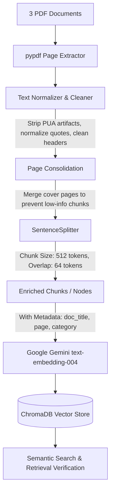

# RAG Chatbot: PDF Ingestion, Chunking & Indexing Pipeline

This repository implements the first and most critical stage of the RAG (Retrieval-Augmented Generation) Chatbot: **Text Ingestion, Cleaning, Semantic Chunking, and Vector Indexing**.

---

## 📚 Attached Source Documents

The system processes and indexes the following 3 corporate documents:
1. **`GROUP EMPLOYEE OPD BENEFITS PLAN BOOKLET 2024-25. (2).pdf`**
   - Outpatient benefits, coverage dates, eligibility (spouses, up to 3 children), medical claim submission process, exclusions, and hotline info.
2. **`Information Asset Protection Policy.pdf`**
   - Classification of information (Confidential, Public, Internal), device security, screen lock rules, encryption requirements, and compliance.
3. **`Monitoring and Logging Policy.pdf`**
   - Background, logging scope, network monitoring, retention schedules, and log review procedures.

---

## 🏗️ Architecture & Pipeline Overview



### Key Technical Decisions:
1. **Text Sanitization**:
   - Replaces non-breaking spaces (`\xa0`) and private use characters (Wingdings bullets `\uf0b7`).
   - Normalizes typographic curly quotes (`“”`) and unicode dashes (`−`, `–`).
   - Cleans repeated document-control header blocks from each page to avoid vector noise.
   - Recombines hyphenated words broken across line wraps.
2. **Page Consolidation**:
   - Short cover pages (e.g. Page 1 title-only pages < 80 chars) are merged into the following content page with page range tracking (e.g. `Page 1-2`).
3. **Sentence-Aware Chunking**:
   - Uses `SentenceSplitter` configured for `chunk_size=512` tokens and `chunk_overlap=64` tokens. Chunks always split on complete sentences or paragraph breaks, never cutting mid-word or mid-sentence.
4. **Rich Metadata**:
   - Every chunk stores: `file_name`, `doc_title`, `category`, `page_number`, `char_count`, and `approx_tokens`.
5. **Persistent Vector Store**:
   - Embeds with Google Gemini (`models/text-embedding-004`) and saves into ChromaDB (`./chroma_db`).

---

## 🚀 How to Run

### 1. Preview & Validate Chunks (No API Key Required)
You can inspect all generated chunks and statistics at any time:
```powershell
.\.venv\Scripts\python.exe preview_chunks.py
```
This generates `chunks_preview.json` containing all 20 structured chunks.

### 2. Configure Your Google Gemini API Key
Open [`.env`](file:///.env) and insert your Gemini API key:
```env
GEMINI_API_KEY=AIzaSyYourActualKeyHere
```
*(Get a free key from [Google AI Studio](https://aistudio.google.com/app/apikey))*

### 3. Run Vector Indexing into ChromaDB
```powershell
.\.venv\Scripts\python.exe run_indexing.py
```
To force a clean reindex:
```powershell
.\.venv\Scripts\python.exe run_indexing.py --force
```

### 4. Launch the Interactive Streamlit Web App 🌐
Run the modern Streamlit web application:
```powershell
.\.venv\Scripts\streamlit.exe run app.py
```
This launches a browser interface with:
- Multi-turn conversational chat with Gemini and ChromaDB
- Direct API key entry and model configuration in sidebar
- Live source citations with relevance scores and expandable context excerpts
- Interactive Document and Chunk Explorer (search and filter all 20 chunks)
- One-click document re-indexing directly from the UI

### 5. Test Semantic Retrieval from Terminal
Verify that the indexed database retrieves accurate chunks:
```powershell
.\.venv\Scripts\python.exe run_indexing.py --query "What is the procedure for OPD claim submissions?"
```

---

## 📁 File Structure

| File | Purpose |
|---|---|
| [`app.py`](file:///c:/Users/Adin/Documents/AntiGravity%20Project/RAG/RAG%20ChatCB/app.py) | Full-featured Streamlit web application with chat UI, source citations & chunk explorer |
| [`rag_engine.py`](file:///c:/Users/Adin/Documents/AntiGravity%20Project/RAG/RAG%20ChatCB/rag_engine.py) | Enterprise RAG chatbot engine with memory, system prompt, and citation extraction |
| [`config.py`](file:///c:/Users/Adin/Documents/AntiGravity%20Project/RAG/RAG%20ChatCB/config.py) | Centralized configuration for chunk sizes, models, paths, and environment variables |
| [`document_processor.py`](file:///c:/Users/Adin/Documents/AntiGravity%20Project/RAG/RAG%20ChatCB/document_processor.py) | PDF text extraction, unicode cleaning, header stripping, and page consolidation |
| [`chunker.py`](file:///c:/Users/Adin/Documents/AntiGravity%20Project/RAG/RAG%20ChatCB/chunker.py) | Semantic sentence-boundary chunking, metadata enrichment, and statistics |
| [`indexer.py`](file:///c:/Users/Adin/Documents/AntiGravity%20Project/RAG/RAG%20ChatCB/indexer.py) | ChromaDB persistent storage, Google GenAI embeddings, and retrieval testing |
| [`preview_chunks.py`](file:///c:/Users/Adin/Documents/AntiGravity%20Project/RAG/RAG%20ChatCB/preview_chunks.py) | Interactive CLI chunk inspector and JSON exporter |
| [`run_indexing.py`](file:///c:/Users/Adin/Documents/AntiGravity%20Project/RAG/RAG%20ChatCB/run_indexing.py) | Primary CLI runner for the pipeline |
| [`chunks_preview.json`](file:///c:/Users/Adin/Documents/AntiGravity%20Project/RAG/RAG%20ChatCB/chunks_preview.json) | Exported JSON dataset of all 20 clean chunks |
